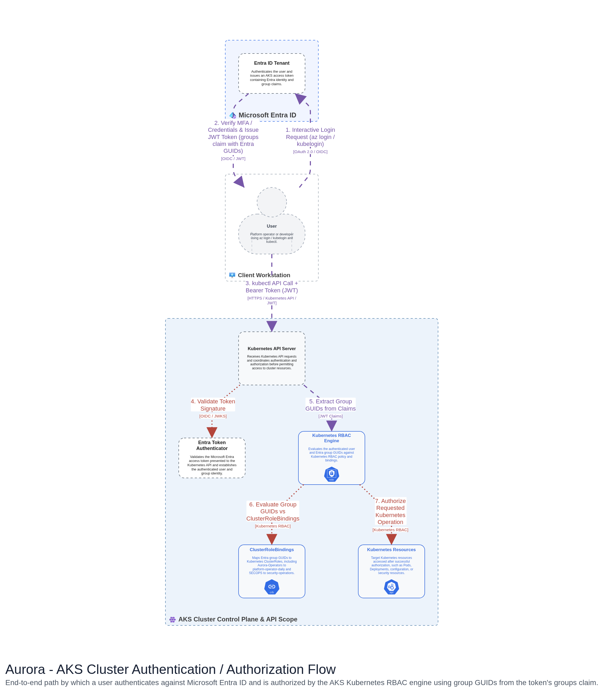
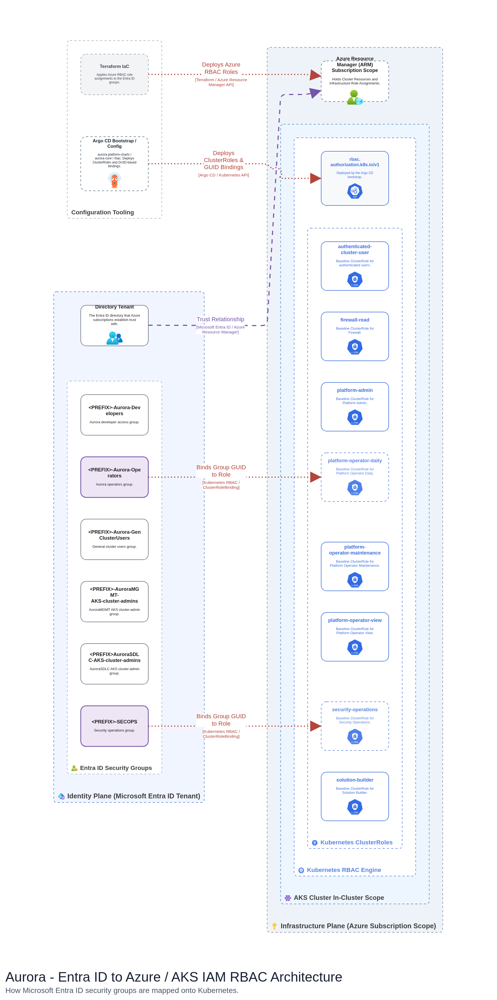



## Objective

This document collects the shared background for Aurora's onboarding SOPs: <gcds-link href="">cluster creation</gcds-link>, <gcds-link href="">platform deployment</gcds-link>, and <gcds-link href="">teardown</gcds-link>.

Most of it is reference material: read the background sections once before you begin so the SOPs can get straight to their steps. It also includes a hands-on walkthrough for connecting to and operating a cluster once it is provisioned. Where a topic below is referenced by a specific SOP, that SOP points back to this document rather than repeating the material.

## How cluster access works

This is reference material describing the identity model; it is not a setup step.

Two Entra ID groups are foundational to cluster access, and they are wired by two different mechanisms:

- **Cluster administrators** (the `*-cluster-admins` group): passed via Terraform into the cluster at creation and mapped to in-cluster administrator RBAC.
- **General cluster users** (the `*-general-cluster-users` group): granted the Azure Kubernetes Service Cluster User Role through Azure RBAC so members can pull the cluster kubeconfig (`az aks get-credentials`). Their in-cluster permissions are then governed by Kubernetes RBAC.

The AKS Authorization Flow below shows the runtime path when a user accesses the cluster. The user authenticates interactively to Entra ID (with MFA), which issues a JWT containing a `groups` claim of Entra group GUIDs. `kubectl` presents that token to the Kubernetes API server, which validates it via the Entra ID OIDC webhook. The Kubernetes RBAC engine then matches the group GUIDs against the cluster's ClusterRoleBindings and grants the corresponding permissions.



Figure 1: AKS Authorization Flow

The Entra ID to Azure / AKS IAM RBAC Architecture below shows how access is structured across three planes. In the identity plane, Entra ID security groups live in the tenant. In the infrastructure plane, Azure (ARM) role assignments at the subscription scope are applied through Terraform. In the in-cluster plane, the Argo CD bootstrap deploys the Kubernetes ClusterRoles and ClusterRoleBindings that bind specific Entra group GUIDs to in-cluster roles. This is the static mapping that the authorization flow in Figure 1 evaluates at runtime.



Figure 2: Entra ID to Azure / AKS IAM RBAC Architecture

## Networking: the flat network model

The flat (non-overlay) network model is the detail that shapes most of the networking decisions in the SOPs: pods receive real, routable IP addresses from a dedicated Pod subnet rather than NAT'd overlay addresses. Three consequences follow, and they matter before the landing zone networking is finalized:

- **Subnet sizing.** The Pod subnet is sized for the maximum number of pods (the `/23` in the network design) and is separate from the node (System) subnet.
- **Source IP.** A pod's traffic egresses from the pod's own IP, not the node's. That pod IP is what you supply as the source on firewall and egress requests; using the node or System subnet instead is a common mistake.
- **Routing and policy.** Because pod IPs are real VNet addresses, they are visible to VNet routing, peerings, and firewall/network policy, all of which must account for the Pod subnet CIDR.

## Connecting to and operating the environment

This walkthrough covers connecting to a provisioned Aurora AKS environment and reaching its dashboards. The placeholders below are the fill-in values for a given tenant; the steps themselves do not change from one tenant to the next.

> **Credentials.** Jumpbox credentials are stored in the Landing Zone Key Vault. Do not embed the jumpbox password in this document or commit it to source control; reference the vault entry and rotate it on a regular cadence.

### Placeholders

| Placeholder             | Meaning                                           |
|-------------------------|---------------------------------------------------|
| `<TENANT_ID>`           | Entra ID tenant GUID used for `az login`          |
| `<TENANT_ENTRA_GROUP>`  | Tenant Entra ID group granting environment access |
| `<WEBTOP_GROUP>`        | Entra ID group granting Webtop access             |
| `<VDC_PORTAL_URL>`      | Virtual Desktop (VDC) portal URL                  |
| `<JUMPBOX_VM>`          | Jumpbox virtual machine name                      |
| `<JUMPBOX_USERNAME>`    | Jumpbox admin username                            |
| `<CLUSTER_RG>`          | AKS cluster resource group                        |
| `<CLUSTER_NAME>`        | AKS cluster name                                  |
| `<CLUSTER_DOMAIN>`      | Tenant cluster ingress domain                     |
| `<ARGOCD_PLATFORM_URL>` | Management-cluster Argo CD (Platform; reader)     |
| `<ARGOCD_SOLUTION_URL>` | Management-cluster Argo CD (Solution; deploy)     |

### Your tenant identity

Entra group: `<TENANT_ENTRA_GROUP>`

### Access you have been granted

| Grant                                       | Scope         |
|---------------------------------------------|---------------|
| Contributor                                 | Subscription  |
| Azure Kubernetes Service Cluster Admin Role | AKS cluster   |
| Azure Kubernetes Service Cluster User Role  | AKS cluster   |
| `<WEBTOP_GROUP>`                            | Webtop access |

### Step 1: Connect to the jumpbox

You reach the cluster and all dashboards through the jumpbox.

1. Open the VDC portal: `<VDC_PORTAL_URL>`
2. Connect to the virtual machine with these credentials:

   | Field           | Value                                                          |
   |-----------------|----------------------------------------------------------------|
   | Virtual machine | `<JUMPBOX_VM>`                                                 |
   | Username        | `<JUMPBOX_USERNAME>`                                           |
   | Password        | Retrieved from the Landing Zone Key Vault (never store inline) |

### Step 2: Access the AKS cluster

Run these commands from the jumpbox.

```sh
az login --tenant <TENANT_ID>
az aks get-credentials --resource-group <CLUSTER_RG> --name <CLUSTER_NAME> --overwrite-existing
kubelogin convert-kubeconfig -l azurecli
```

You now have `kubectl` access to your cluster.

> Note: Since this is a private cluster, access is brokered through the jumpbox (Azure Bastion) or Azure Virtual Desktop (AVD).

### Step 3: Dashboards and tools

You reach every dashboard below through the jumpbox.

#### Platform Dashboards (management cluster)

These run in the Aurora management cluster, not in your cluster. That is why you will not see Argo CD inside your own cluster.

Your access differs by dashboard:

- Platform: SSC deploys it. You have reader access.
- Solutions: you have full access to deploy your solutions onto your cluster.

| Dashboard         | URL                     | Your access   |
|-------------------|-------------------------|---------------|
| Argo CD, Platform | `<ARGOCD_PLATFORM_URL>` | Reader        |
| Argo CD, Solution | `<ARGOCD_SOLUTION_URL>` | Full (deploy) |

> **Known issue.** Routing to the Argo CD dashboards is still being finalized, so these URLs may not resolve yet. This will be confirmed once routing is in place.

#### Solution Dashboards (your cluster)

These services run in your cluster.

| Dashboard    | URL                                            |
|--------------|------------------------------------------------|
| Grafana      | `https://grafana.aurora.<CLUSTER_DOMAIN>`      |
| Prometheus   | `https://prometheus.aurora.<CLUSTER_DOMAIN>`   |
| AlertManager | `https://alertmanager.aurora.<CLUSTER_DOMAIN>` |
| Kiali        | `https://kiali.aurora.<CLUSTER_DOMAIN>`        |
| Hubble       | Pending                                        |
